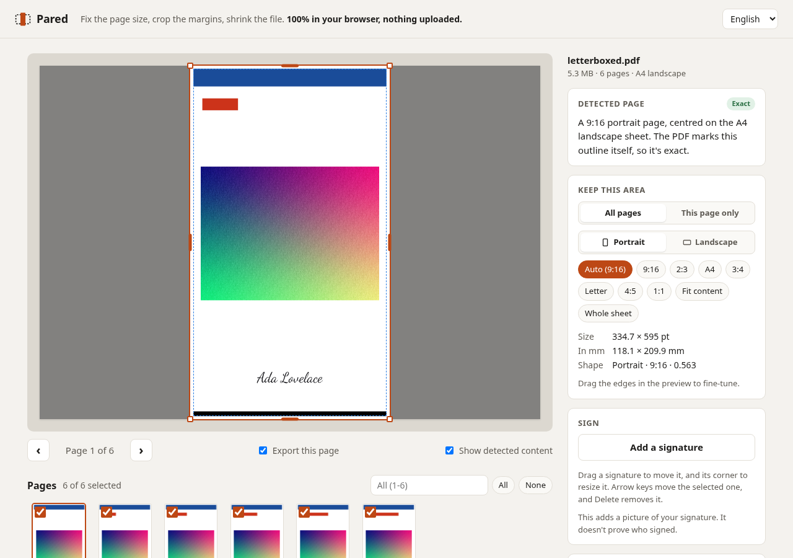
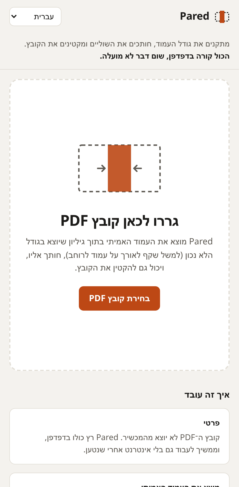

# Pared

Fixes PDFs exported at the wrong page size, such as a 9:16 portrait slide placed in the middle of an A4 landscape page. Pared:
- detects the real page,
- crops every page to it,
- lets you choose which pages to keep, reorder and rotate them,
- can add a typed, drawn or photographed signature,
- can compress the images.

The interface is in English, Hebrew, Arabic and Spanish.

Everything runs in the browser: the PDF is never uploaded.

**Try it:** https://paredpdf.github.io/

<p>
  
  
</p>

## Run locally

```sh
python3 -m http.server 8765   # from the repo root
# open http://127.0.0.1:8765/
```

It has to be served over HTTP, because ES modules and workers don't load from `file://`. There's no build step. Deploy the folder as-is to any static host (GitHub Pages, Cloudflare Pages, Vercel).

The live site is deployed by GitHub Actions once the tests pass (Settings → Pages → Source must be "GitHub Actions"). The deploy job runs `scripts/stamp.js` to write the commit and deploy time into `index.html`, and the footer shows them with a link to the commit. A copy served straight from the repo shows no version.

## Tests

```sh
npm install
npm test
```

The tests use Node's built-in test runner and cover page detection (`detect.js`), page-range parsing (`pages.js`) and the export engine (`pdf-core.js`). The engine tests run against mupdf 1.28.1, the same version the site loads, and build their test PDFs in code. GitHub Actions runs them on every push to `main` and on pull requests.

Browser tests use Playwright, in Chromium (desktop and Pixel 7), Firefox, and WebKit (desktop Safari and iPhone 14):

```sh
npm run browsers          # downloads the browsers into .browsers/ in this folder
npm run test:e2e          # all of them
npm run test:e2e -- --project=desktop --project=firefox   # some of them
```

`test/e2e/a11y.spec.js` runs axe (WCAG 2.1 A and AA) on every screen: the start screen, the working screen, the signature dialog, a placed signature, and the warnings, in light and dark mode and in a left-to-right and a right-to-left language.

`PARED_CHROMIUM=/usr/bin/chromium` uses an installed Chromium instead of a download. WebKit needs Ubuntu's system libraries, so on other Linux systems leave it to CI, which runs each engine as its own job.

## Files

- `detect.js` holds the page detection logic. It has no DOM or pdf.js dependencies.
  - Draws up to 40 pages for each page size and combines the non-background area of all of them.
  - Assumes the real page is centred, so the empty bands on two sides tell it which way to crop.
  - Picks the smallest common aspect ratio that still contains all the content.
- `pages.js` parses and formats page ranges such as `1-5, 8, 10-`.
- `i18n.js` holds the interface text in English, Hebrew, Arabic and Spanish. Hebrew and Arabic switch the page to right to left: thumbnails run right to left, and the arrow keys and drag-to-reorder follow. The preview and its crop handles keep their physical sides. The language comes from `?lang=`, then the language menu in the header (remembered on this device), then the browser's language. Sizes, file names and measurements are wrapped in bidi isolates so they stay in one piece inside right-to-left sentences. Arabic page counts use its plural forms, and page ranges accept the Arabic comma (،).
- `app.js` handles the UI: preview, draggable crop box, orientation switch, ratio presets, page thumbnails and selection, and the export controls. It uses pdf.js for rendering.
- `pdf-core.js` is the export engine, built on mupdf.js. It runs in the browser worker and in Node (handy for tests).
  - Sets the page boxes and keeps only the selected pages.
  - **Compression:** works out the largest size each image is drawn at, by walking content streams, form XObjects included. It then resamples to the target ppi with a box filter and re-encodes as JPEG.
  - **Skipped images:** 1-bit, tiny, and already-JPEG images at a sensible resolution. Also lossless images that compress well (logos, screenshots), since JPEG would only blur them.
  - Soft masks (transparency) are resized along with their image.
  - Saves with garbage collection, so skipped pages' images are actually removed.
  - **Existing signatures:** `inspectPdf` counts signed signature fields. Exporting rewrites the file, which breaks a digital signature, so the page warns first. pdf.js spots signature fields cheaply, and mupdf is only asked when there are some, since pdf.js can't tell signed from empty.
  - **Size estimate:** `estimateSizes` predicts the exported size at each resolution before you export. The uncompressed size is a real save, so it's exact. For each resolution it encodes the three largest images that would be shrunk and assumes the rest compress to the same bytes per pixel. It runs in its own short-lived worker after analysis and when the page selection changes, and is skipped for files too large for the device.
- `sign.js` handles visual signatures: typing a name in a handwriting font (Dancing Script, Caveat, Gveret Levin for Hebrew, Aref Ruqaa for Arabic; only styles that can write the typed letters are offered), a drawing pad (smoothed strokes, stored as points so they redraw sharp at any size), and turning a photo or scan into transparent ink, with the paper level taken from the image itself so grey phone photos come out clean. On export each placed signature is rendered as a PNG for 300 ppi at its size on the page, and the engine draws it on top of the page content. It's a picture of a signature, not a digital signature, and the page says so.
- `sw.js` is the service worker that makes the site work offline after the first visit. App files are network-first (so deploys show up on the next load), and `vendor/` is cache-first under a cache name that includes the library versions.
- `export-worker.js` runs the engine off the main thread and uses the browser's JPEG encoder (4:2:0 chroma, much smaller than mupdf's 4:4:4).

pdf.js 4.10.38, mupdf 1.28.1 and the signature fonts (from Fontsource, SIL Open Font License, licences alongside) are served from `vendor/`, so the site makes no third-party requests. `npm run vendor` copies them from `node_modules` after a version change, and a test fails if `vendor/` drifts from `package.json`. The mupdf engine (10 MB) starts loading in the background once analysis finishes.

## Licence

AGPL-3.0 (see `LICENSE`), matching mupdf.js, which Pared uses for export.

## Results on the Tzafit guide (152 MB, 50 pages)

| Export | Size | Time |
|---|---|---|
| 150 ppi | 5.7 MB | ~15 s |
| 200 ppi | 10.7 MB | ~18 s |
| 300 ppi | 25.0 MB | ~15 s |
| Pages 6–9, no compression | 8.7 MB | — |

## Next

- Testing on real phones, including iOS Safari.
